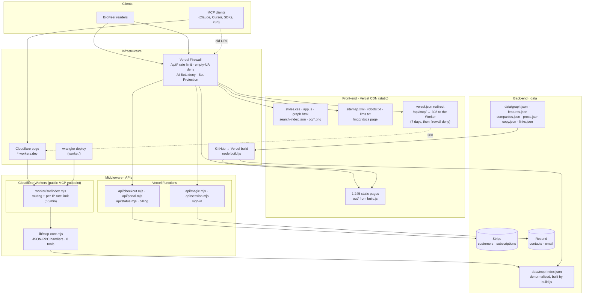
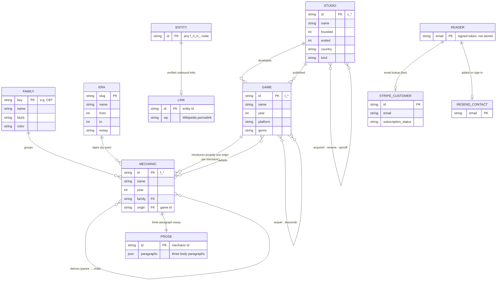

# Architecture

The Genome of Games has three moving parts. The site is static HTML on Vercel. A handful of
Vercel Functions handle sign-in and billing. The public MCP server runs on a Cloudflare Worker.
There is no database: the dataset is committed JSON and the account system is a signed token.

> **Why the MCP server moved (October 2026).** The open MCP endpoint was ~98% of this
> project's Vercel traffic. That was ~84% of the whole team's CDN requests and ~97% of its
> function invocations, enough to push the team past Vercel Hobby limits. The server now runs on
> Cloudflare Workers with a per-IP rate limit. The server code did not change:
> `lib/mcp-core.mjs` uses only the Fetch API, so it moved hosts as-is.

## Systems architecture, by layer

| Layer | Component | Where it runs | Notes |
|---|---|---|---|
| Front-end | Static pages, assets, `llms.txt`, `/mcp/` docs | Vercel CDN | No runtime. Built by `build.js` into `out/` |
| Middleware | MCP server (`lib/mcp-core.mjs`) | **Cloudflare Worker** `genome-of-games-mcp` | The public endpoint. Per-IP rate limit of 60/min via the Workers Rate Limiting binding |
| Front-end | `/api/mcp/` | Vercel CDN | Transitional. A `vercel.json` 308 to the Worker, no function. MCP SDK clients don't follow cross-origin redirects by default and fail with an error naming the new URL; generic HTTP clients follow it. Replaced by a firewall deny after 7 days |
| Middleware | Sign-in, billing (`api/*.mjs`) | Vercel Functions | Zero dependencies, `fetch` only |
| Back-end | Dataset JSON, `mcp-index.json` | Committed to git, bundled into the Worker | Read-only. Changing data means a rebuild and a redeploy |
| Back-end | Stripe, Resend | SaaS | The only state outside git |
| Infrastructure | Vercel Firewall, Cloudflare edge, GitHub → Vercel build, `wrangler deploy` | — | Firewall config is managed team-wide by the edge-guard template |

The public MCP URL lives in one place: `MCP_ENDPOINT` in `lib/data.js` (override it with the
`MCP_ENDPOINT` env var). `build.js` writes it into the docs page, `llms.txt`, and
`meta.endpoint` in `data/mcp-index.json`, and the server's own GET description reads it from there.

## Data model (ERD)

There is no database. These are the entities in the committed JSON and how they relate.
`graph.json` holds the 1,180 nodes and 4,366 typed edges. `features.json` and `companies.json`
are the editable sources. `mcp-index.json` is a denormalised projection of all of it, built for
the MCP server.

| Edge kind | From → To | Count |
|---|---|---|
| `adopts` | game → mechanic | 2,487 |
| `developed` | studio → game | 617 |
| `published` | studio → game | 376 |
| `derives` | mechanic → mechanic | 199 |
| `sequel` | game → game | 198 |
| `introduces` | game → mechanic | 168 |
| `acquired` | studio → studio | 155 |
| `descends` | game → game | 110 |
| `spinoff` | studio → studio | 42 |
| `rename` | studio → studio | 14 |
